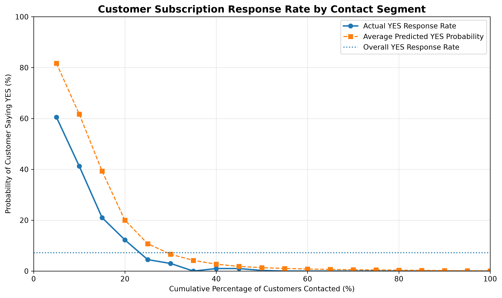

### Model Performance and Business Impact

I selected a probability threshold of **0.53** because it provided the preferred balance between identifying potential subscribers and minimizing incorrect positive predictions. The model achieved **93.23% accuracy**, exceeding the established benchmark of 81.54% by **11.69 percentage points**.

In practical terms, the model successfully identifies approximately **68 out of every 100 customers who actually subscribe** to a term deposit. However, it misses approximately 32 out of every 100 potential subscribers, representing opportunities the bank could potentially lose.

When the model predicts that a customer will subscribe, it is correct approximately **52% of the time**. This means that some customers contacted based on the model's predictions may not ultimately subscribe.

Overall, the results demonstrate that the model can help the bank identify potential subscribers, prioritize customer outreach, and make more informed decisions about allocating telemarketing resources.

### Customer YES Probability Curve

The Customer YES Probability Curve illustrates how the XGBoost model ranks customers according to their likelihood of subscribing to a term deposit.

By prioritizing customers with higher predicted subscription probabilities, the bank can focus its initial telemarketing efforts on individuals who are more likely to respond positively.

As the percentage of customers contacted increases, successive customer segments generally demonstrate lower subscription rates. This indicates that customers ranked lower by the model are less likely to subscribe, highlighting the potential for more efficient customer targeting.

The overall YES response rate of **7.24%** provides a benchmark for evaluating whether individual customer segments perform better or worse than the average customer population.

**Business Insight:** The visualization demonstrates how predictive modeling can support more targeted marketing campaigns by helping the bank prioritize potential subscribers, improve resource allocation, and reduce unnecessary customer outreach.
### Customer YES Probability Curve

